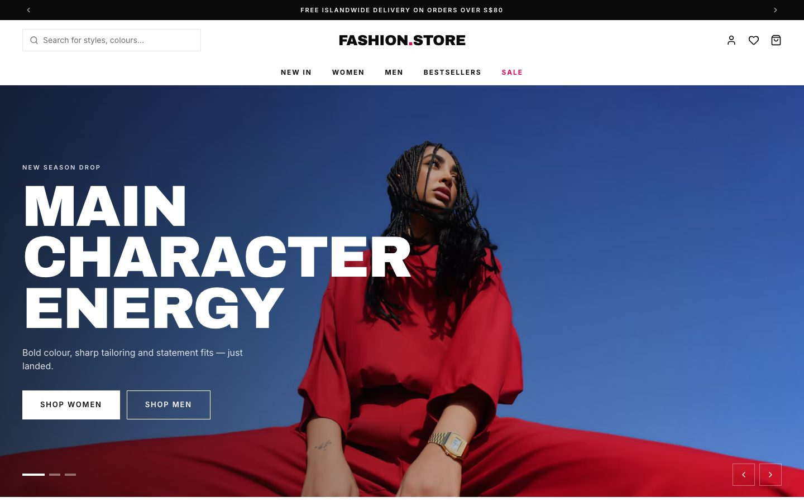
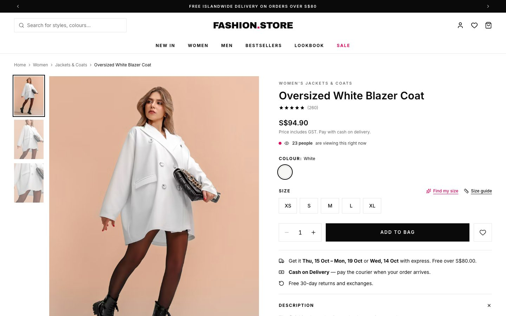
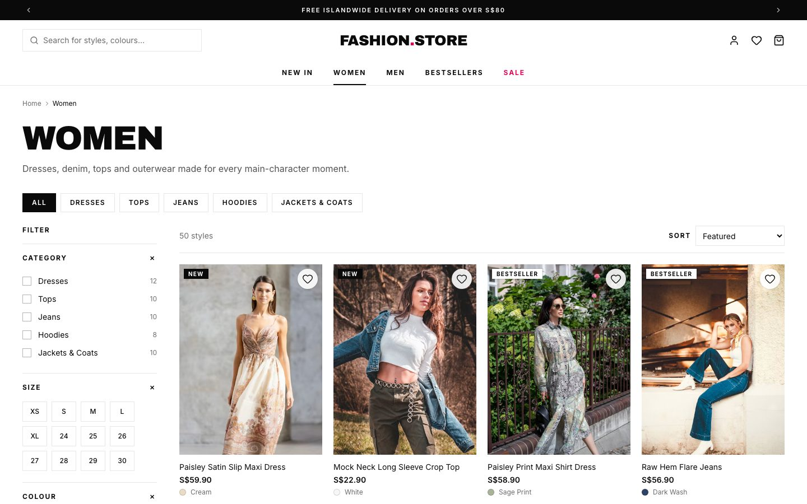
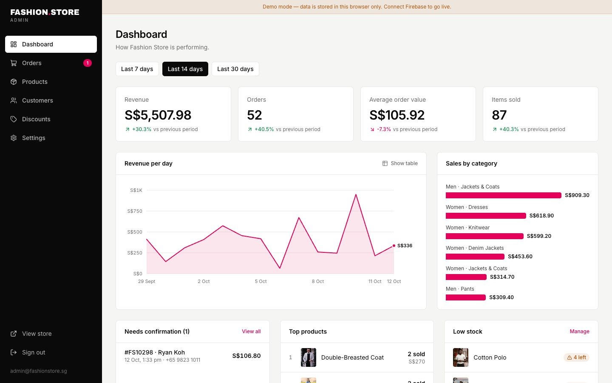
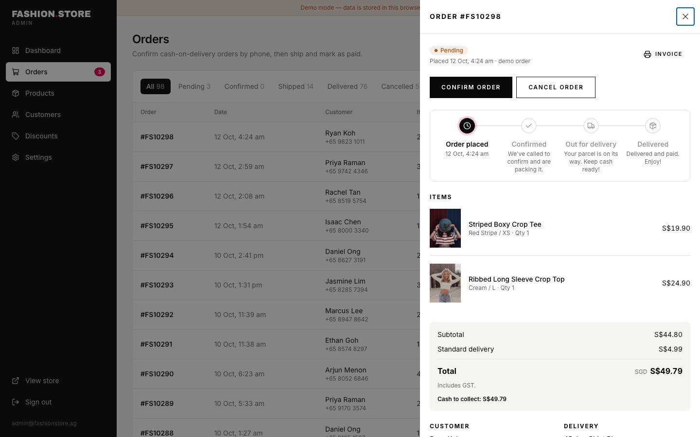
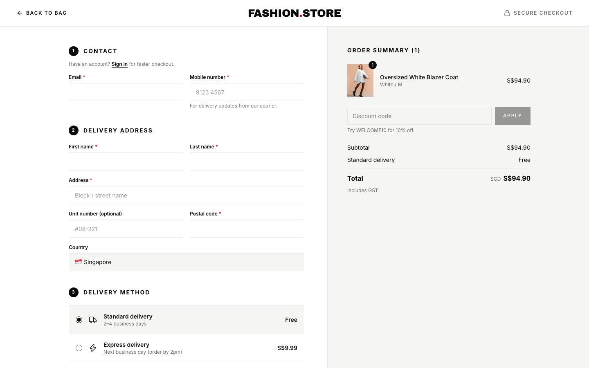
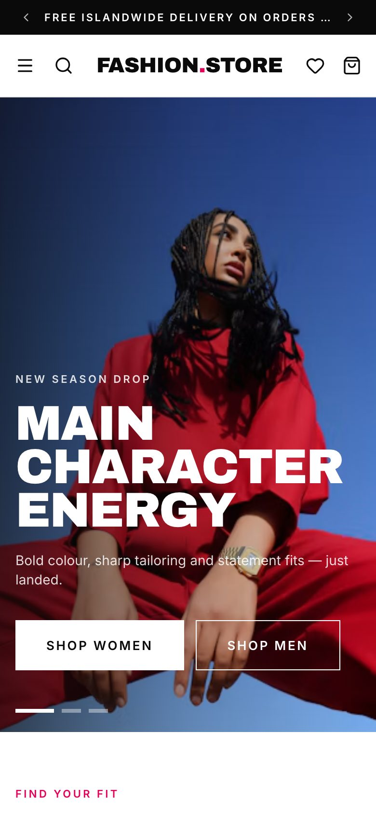

# Fashion Store

A modern fashion e-commerce storefront and admin panel for women's and men's clothing in Singapore. It has bold, editorial styling, 100 products, Cash on Delivery checkout and a full admin dashboard.



> **MVP status:** This build runs entirely in the browser and has no backend. Orders, product edits, accounts and settings are saved in the visitor's browser (localStorage), so you can try every flow end to end. The data layer is isolated so it can be moved to Firebase (Firestore, Auth, Storage) without rewriting the UI. See [Going live](#going-live-with-firebase).

## Try it

```bash
npm install
npm run dev
```

Open http://localhost:3000.

| What | Where | Login |
| --- | --- | --- |
| Storefront | `/` | — |
| Admin panel | `/admin` | `admin@fashionstore.sg` / `admin123` |

Discount codes to try at checkout: `WELCOME10` (10% off), `STYLE20` (20% off over S$120), `SAVE15` (S$15 off over S$100), `FREESHIP`.

## Features

### Storefront
- **Home page:** autoplay hero slider, shop-by-category tiles, New Arrivals (Women/Men tabs), sale banner, Bestsellers, Denim edit, social grid and newsletter signup
- **Collections:** 16 collections, each with filters for category, size, colour family, price, in-stock and on-sale. Sorting, "load more" and a mobile filter drawer are included.
- **Product pages:** swipeable gallery with zoom, size selector with low-stock alerts, size guide, delivery-date estimate, fabric and care details, reviews with "write a review", recommendations and recently viewed. A sticky add-to-bag bar appears on mobile.
- **Search:** instant search overlay with popular searches, plus a full results page with filters
- **Bag:** slide-out drawer and a full bag page, free-delivery progress bar and discount codes
- **Checkout:** distraction-free layout with Singapore phone and postal-code validation, Standard or Express delivery, and **Cash on Delivery**. Cards and PayNow are shown as "coming soon".
- **After purchase:** order confirmation, status timeline and an order tracker that looks orders up by number plus email or phone
- **Accounts:** sign up, sign in, order history and a saved address
- **Content pages:** About, Contact, FAQ, Shipping, Returns, Size Guide, Privacy, Terms and Photo Credits
- **Quality:** fully responsive, keyboard accessible, SEO metadata, Product JSON-LD, sitemap, robots.txt and an Open Graph image

### Admin panel (`/admin`)
- **Dashboard:** revenue, orders, average order value and items sold, each compared with the previous period. Includes a daily revenue chart (with a table view), sales by category, orders awaiting confirmation, top products and low-stock alerts.
- **Orders:** status tabs, search and CSV export. The order drawer has a confirm → ship → deliver workflow, cancel with automatic restock, a printable invoice, and one-tap call or WhatsApp to the customer.
- **Products:** search and filter the catalogue, then add, edit or delete products. You can set pricing and sale prices, stock per size, draft or active status, and New/Bestseller flags. Images can be uploaded or added by URL. Changes show on the storefront instantly.
- **Customers:** list built from orders, showing lifetime spend, with CSV export
- **Discounts:** create, toggle and delete percentage, fixed-amount and free-delivery codes
- **Settings:** announcement bar messages, delivery fees, free-delivery threshold, a Cash on Delivery switch, store contact details and a demo data reset

<table>
  <tr>
    <td></td>
    <td></td>
  </tr>
  <tr>
    <td></td>
    <td></td>
  </tr>
  <tr>
    <td></td>
    <td>
      
      
    </td>
  </tr>
</table>

## Tech stack

- [Next.js 16](https://nextjs.org) (App Router) with React 19 and TypeScript
- Tailwind CSS v4
- [Zustand](https://zustand.docs.pmnd.rs) for state (bag, wishlist, orders, catalogue edits), persisted to localStorage
- [Lucide](https://lucide.dev) icons
- Static export (`output: "export"`), so the site can be hosted on any static host, including Firebase Hosting on the free plan
- Product and campaign photography from [Unsplash](https://unsplash.com), served from their CDN

## Scripts

| Command | What it does |
| --- | --- |
| `npm run dev` | Start the dev server |
| `npm run build` | Build the static site into `out/` |
| `npm run lint` | Lint the code |
| `npm run fetch:images` | Re-fetch candidate photos from Unsplash (needs `UNSPLASH_ACCESS_KEY`, see `.env.example`) |
| `npm run build:catalog` | Regenerate `src/data/products.json` from the curated picks |

## Project structure

```
src/
  app/
    (store)/          storefront routes (home, collections, products, cart, account…)
    checkout/         checkout with its own minimal layout
    admin/            admin panel routes
  components/         UI grouped by area (layout, product, cart, home, admin…)
  data/               seed catalogue (100 products) and photo metadata
  lib/
    store/            Zustand stores: the data layer to swap for Firebase
    services/         checkout and order lookup ("backend" logic)
    catalog.ts        product helpers and image crops
    pricing.ts        subtotal, discounts and delivery rules
scripts/              Unsplash fetch and catalogue builder
```

## Deploy (Firebase Hosting)

```bash
npm run build
firebase login
firebase use --add            # pick or create the Firebase project
firebase deploy --only hosting
```

`firebase.json` is already set up to serve `out/` with trailing slashes, long-term caching for static assets and the custom 404 page.

## Going live with Firebase

The MVP keeps all backend concerns in `src/lib/store/*` and `src/lib/services/*`. To go live:

1. **Auth:** replace the demo accounts and admin login (`src/lib/store/auth.ts`) with Firebase Authentication. Use custom claims for admin users.
2. **Firestore:** move `products`, `orders`, `discounts` and `settings` into collections. Swap the Zustand stores for Firestore reads and real-time listeners.
3. **Orders:** turn `placeOrder()` into a Cloud Function (or Firestore transaction) that re-checks prices and stock on the server.
4. **Storage:** upload product images to Cloud Storage instead of data URLs (`src/lib/image-upload.ts`).
5. **Notifications:** send order confirmation emails, plus Telegram or WhatsApp alerts to the store team for new orders.
6. **Payments:** add card and PayNow (for example via Stripe) alongside Cash on Delivery.

## Credits

Photography by the talented creators on [Unsplash](https://unsplash.com). Each photographer is listed on the in-store [Photo credits](src/app/(store)/credits/page.tsx) page. Brand, copy and design are original; the visual direction is inspired by contemporary fast-fashion retailers.
